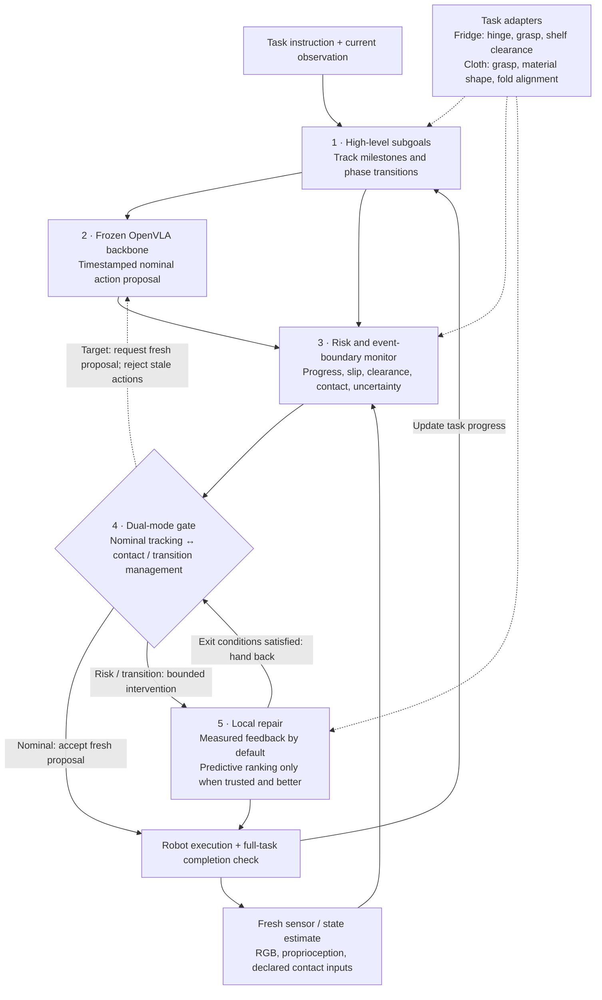

# UoE-UG4-Dissertation

## Five-layer runtime verification–repair architecture

**Demo targets: refrigerator retrieval and cloth / garment folding.** The shared
runtime wrapper monitors execution, applies bounded repair, and returns control
to a frozen VLA. [Demo milestones and paper experiments](exp_record/agent_notes/two_demo_experiment_design_20261019.md).

**Current research claim to test:** event/phase-aware closed-loop recovery beyond
predictor-free simple feedback, with validated handoff and complete-task outcomes.
Differentiable prediction is an optional, separately ablated mechanism.
[Revised research and R1 diagnosis protocol](exp_record/agent_notes/closed_loop_recovery_r1_20261019.md).

The central theme remains **verify → bounded repair → reverify → handoff**.
[Visual/physical evidence boundaries and ICLR-quality experiment targets](exp_record/agent_notes/verification_repair_iclr_20261019.md).

**Default experiment videos:** baseline VLA on the left, our framework on the right;
matched initial conditions, common playback speed, phase/intervention/handoff labels
and explicit end-frame holds. Engineering-only controllers are labeled as such.

**Current priority:** [diagnose why the original VLA stalls](exp_record/agent_notes/vla_failure_audit_execution_20261019.md).
R2's first grasp/extraction occurred under hand-written motion primitives, so they
do not demonstrate autonomous repair. Further route scripting is paused. Actor-only
task/camera/official-inference controls are running; a6-observation pinned
decode audit already finds one action discrepancy, retained rather than dismissed.

**Implementation status:** assembly-specific monitoring/gating/repair has been
evaluated; refrigerator and folding adapters are under development. Current runs
query the actor synchronously (~0.71 s/action). **Target real-time design:** a slow
asynchronous VLA proposal loop and a fast fresh-feedback monitor/repair loop, with
proposal-age limits, exclusive action ownership and measured response deadlines.
This dual-rate scheduler is not yet implemented or validated. Simulator state used
by current controllers is privileged; sensor-based estimation is a separate stage.

Undergraduate (UG4) dissertation project — University of Edinburgh.

**Title:** Integrating Neural Physics Engines into Embodied Foundation Models for Enhanced Physical Reasoning and Robust Generalization in Embodied Agents

**Current focus (19 Oct 2026):** build two demonstrators—refrigerator retrieval and cloth/garment folding—and test whether the shared runtime framework improves complete-task recovery. [Week5](exp_record/week5.md) · [demo and paper design](exp_record/agent_notes/two_demo_experiment_design_20261019.md) · [data/OOD contract](exp_record/agent_notes/unstructured_ood_design_20261019.md). [First refrigerator probes completed and replay-verified](exp_record/agent_notes/fridge_development_execution_20261019.md): neither native-actor trial retrieved the item; task-capability integration is the next step. Folding manipulation and dual-rate real-time control remain implementation milestones.

**Locked architecture:** high-level subgoals → frozen OpenVLA → risk/event-boundary monitoring → dual-mode gate → bounded local repair. [Authoritative design](exp_record/agent_notes/libero_framework_design_20261014.md) · [layer-by-layer implementation / next long-horizon task](exp_record/agent_notes/libero_five_layer_implementation_20261014.md).

**Latest completed experiment:** [R2: actual frozen VLA / refrigerator wrapper](exp_record/agent_notes/fridge_r2_results_20261019.md), four600-action/query trials. Closed-start arms both fail to open; open-start wrapper grasps/extracts but does not complete placement/retrieval. Both wrapper runs use420corrections. [Baseline-left / framework-right videos and all-case archive](backups/fridge_r2_20261019/README.md). This is privileged, scene-specific development; per-scene coordinate tuning is paused in favor of testing one frozen repair across held-out layouts/instances. Three exact replays pass; the fourth has only two wrist-frame pixel discrepancies. The results include a correction to overwritten local-exit event labels.

**Earlier assembly evidence:** [A2:80/80verified trajectories](exp_record/agent_notes/assembly_a2_results_20261019.md). VLA8/20; shared-gate geometric feedback and hybrid18/20. Prediction ranking never overrides geometry, and the hybrid harms one baseline success. [VLA-left / hybrid-right paired videos, including negative cases](backups/assembly_a2_paired_review_20261019/README.md).

**[Videos, artifact backup and recovery instructions](backups/README.md)** · **[Pinned LIBERO submodule](third_party/LIBERO)**. Large experiment files use Git LFS; clone with submodules and run `git lfs pull` to restore them.

## Contents

- [`core_research_plan.md`](core_research_plan.md) — authoritative research plan and current scope (Oct 2026 – Sep 2027)
- `notes/` — proposals, experiment plans, papers, figures and working notes
  - `Dissertation_Proposal_gsu.pdf` — original dissertation proposal
  - `Dissertation_Proposal_gsu_new_sep_19.md` — revised proposal (Genesis, causal/structured Physical CoT, VLA/Embodied Data Pyramid updates)
  - `Experiment_Phase_0.md` — Phase 0/1 benchmark plan (Robosuite NutAssembly, Diffusion Policy, OOD friction/mass evaluation)
  - `Experiment_plan_Phase_1.md` — Phase 1 plan: CheckVLA + OrbiSim-Dynamics + Genesis execution-time physical verification
  - `Experiment_plan_1year.md` — historical one-year planning notes; current scope is in the root plan above
  - `note.md` — working notes
- `exp_record/` — weekly summaries; detailed protocols/results in `exp_record/agent_notes/` (see `exp_record/README.md`)
- `src/` — Phase 1 experiment framework (see `src/README.md`)
