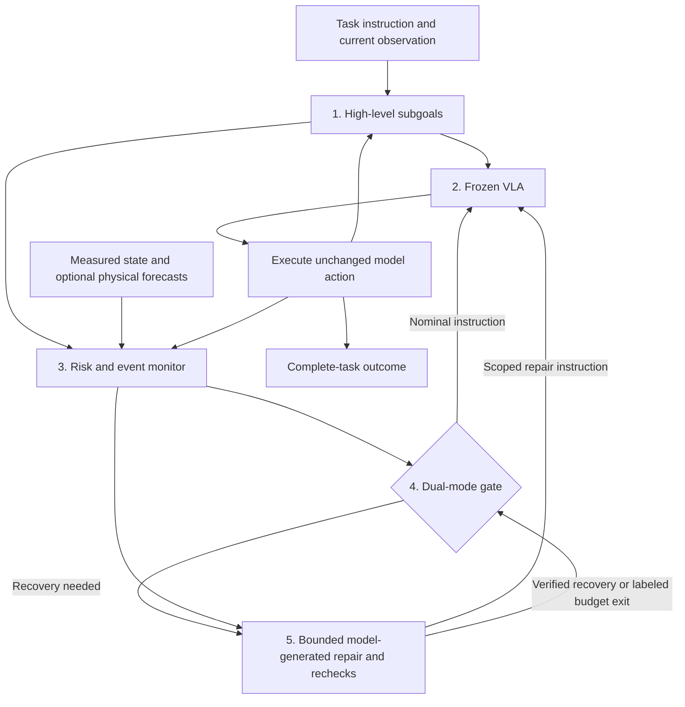

# Verification and Repair for Frozen VLAs

University of Edinburgh UG4 dissertation: **runtime verification coupled to bounded, model-generated repair**, evaluated through complete-task reliability in unstructured manipulation.

## Objective

**Core research question:** how should a verifier guide intervention, check recovery and support reliable resumption of a frozen VLA? When does physical prediction improve this loop beyond measured feedback?

The **verifier–repair loop is the method**, **full-task completion is the primary outcome**, and **unstructured microwave/refrigerator manipulation is the application and generalization setting**. The five-layer architecture below implements this research subject.

The current microwave benchmark is a controlled development setting. The new runtime generates task semantics and recovery contracts from **natural-language instructions, images and a scene entity inventory** using a vision-capable language model. Its controller is task-independent; real-model task transfer remains to be evaluated.

**[Research plan](core_research_plan.md)** · **[Current protocol and run status](exp_record/agent_notes/current_goal_and_experiment_queue_20261019.md)** · **[Week 5](exp_record/week5.md)**

## Our Five-Layer Framework

1. **Generated task semantics:** grounded goals and optional progress milestones.
2. **Frozen VLA:** generate nominal and repair actions from current observations.
3. **Visual–physical event monitoring:** measured progress plus optional trained risk, retrieved context and causal short-term forecasts.
4. **Dual-mode gate:** decide between nominal execution and bounded intervention.
5. **Local repair and reverification:** check recovery, preserve progress, and execute a fresh nominal handoff.

**Verification is central.** The planner proposes semantic goals; measured predicates determine whether they hold. Unknown evidence never verifies a contract. Every task/repair numerical action comes from frozen OpenVLA. A learned physical predictor is not enabled. Historical microwave results below used manually declared semantics, not the new generated-task implementation.

## Task-agnostic runtime

- Experiment home: [`src/experiment/`](src/experiment/README.md).
- Shared entry point: `python -m src.experiment.run_task`; microwave: `python -m src.experiment.microwave --arm …`.
- Architecture and backend interfaces: [runtime guide](docs/task_runtime.md).
- Cross-machine setup and staged checks: [GPU setup](docs/gpu_setup.md) and the top of [Week 5](exp_record/week5.md).
- CPU checks: `python -B -m unittest discover -s src/experiment/tests` (optional extra torch test).
- Main components: `src/planning/`, `src/controller.py`, `src/runtime.py`, `src/verification/physical_verifier.py` and environment/model bridges in `src/adapters/`.
- No per-task Python adapter or JSON goal configuration. The LIBERO bridge supplies scene IDs and measurements for any supported task; the MLLM generates the task and recovery records.
- Visual encoding, visual subgoals, memory retrieval, short-term prediction and learned risk/A/B implementations are retained and connected to the new runtime; see [component status](src/COMPONENT_STATUS.md).
- CPU integration and synthetic head-training coverage are not evidence of real-model efficacy. Real MLLM/OpenVLA/DINO rollouts, grounding accuracy and useful compatible trained risk/A/B artifacts remain pending.

## Experiments and Evidence

**Latest completed paired experiment (v2):** bare VLA **4/6**, framework **4/6**, with zero rescues and zero harms. All 12 episodes passed exact replay. The previous root3 harm disappeared, but the root4 rescue was lost. One repair passed local verification and actually handed back; containment was lost on the first nominal action and the task failed. No net completion improvement or verified-recovery-to-completion gain has yet been established.

- [Latest v2 comparison, six full paired videos and raw evidence](backups/framework_comparison_20261021/README.md)
- [First comparison: one rescue and one harm](backups/framework_comparison_20261019/README.md)
- [Historical refrigerator R2](exp_record/agent_notes/fridge_r2_results_20261019.md): geometric correction actions, local extraction progress, no full completion; separate from the current model-generated repair method.

**Historical post-v2 study:** a complete-task placement-prompt / measured-resumption-gate comparison was launched from frozen source `528a91c`. Its launch and results belong to that archived protocol; see the [experiment record](exp_record/agent_notes/current_goal_and_experiment_queue_20261019.md) and [session recovery status](exp_record/agent_notes/session_recovery_status_20261023.md). These outcomes are not results of the generated-task runtime.

The historical paired evidence includes full baseline/framework videos and replay audits. New-runtime runs do not yet have independent tape replay; do not describe them as replay-audited results.

## Code and Records

| Path | Purpose |
|---|---|
| [`core_research_plan.md`](core_research_plan.md) | Current objective, method, experiment sequence and evaluation |
| [`src/experiment/`](src/experiment/README.md) | Microwave arms, shared runner, collection, training CLI, summary and tests |
| [`src/controller.py`](src/controller.py) | Task-independent budgets, repair verification and handoff |
| [`src/interfaces.py`](src/interfaces.py) | Environment, policy, planner and optional A/B contracts |
| [`src/README.md`](src/README.md) | Current component layout and implementation status |
| [`src/experiment/tests/`](src/experiment/tests) | CPU runtime/component/experiment checks |
| [`exp_record/`](exp_record/agent_notes/experiment_record_index.md) | Weekly summaries; detailed protocols and results under `agent_notes/` |
| [`backups/`](backups/README.md) | Published videos, raw evidence and recovery instructions |
| [`third_party/LIBERO`](third_party/LIBERO) | Pinned benchmark submodule |
| `notes/` | Proposals, literature and historical planning |

Run checks with `python -B -m unittest discover -s src/experiment/tests`. Obsolete
controllers/runners and fixed-stage training paths have been removed; historical experiments require their archived
sources or original Git revisions. Records, results and weights are preserved.
The source API is `from src import Session, Limits, Proposal`; installation as a
package is deferred. Inspect runner options with `--help`.

Large artifacts use Git LFS. Clone with submodules and follow each backup's scoped LFS recovery instructions.

**Registered dissertation topic:** *Integrating Neural Physics Engines into Embodied Foundation Models for Enhanced Physical Reasoning and Robust Generalization*.
