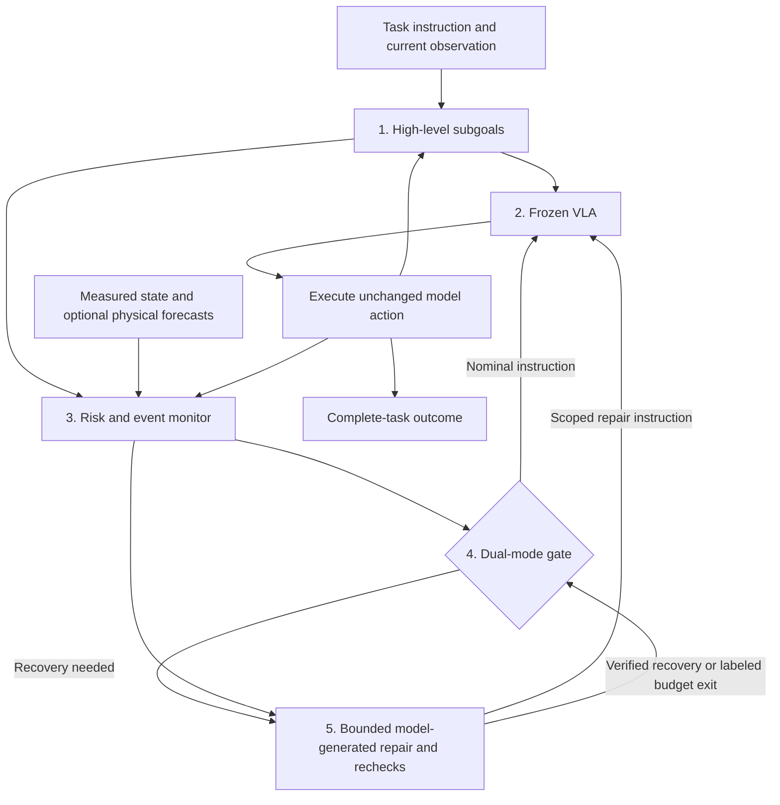

# Verification and Repair for Frozen VLAs

University of Edinburgh UG4 dissertation: **runtime verification coupled to bounded, model-generated repair**, evaluated through complete-task reliability in unstructured manipulation.

## Objective

**Core research question:** how should a verifier guide intervention, check recovery and support reliable resumption of a frozen VLA? When does physical prediction improve this loop beyond measured feedback?

The **verifier–repair loop is the method**, **full-task completion is the primary outcome**, and **unstructured microwave/refrigerator manipulation is the application and generalization setting**. The five-layer architecture below implements this research subject.

The current microwave benchmark is a controlled development setting. Generalization to unstructured object placements, layouts and contact conditions requires subsequent held-out evaluation.

**[Research plan](core_research_plan.md)** · **[Current protocol and run status](exp_record/agent_notes/current_goal_and_experiment_queue_20261019.md)** · **[Week 5](exp_record/week5.md)**

## Our Five-Layer Framework

1. **High-level subgoals:** track stages, prerequisites and achieved milestones.
2. **Frozen VLA:** generate nominal and repair actions from current observations.
3. **Risk/event monitoring:** observe progress, contact transitions, release, loss and uncertainty.
4. **Dual-mode gate:** decide between nominal execution and bounded intervention.
5. **Local repair and reverification:** check recovery, preserve progress, and execute a fresh nominal handoff.

**Verification is central.** Physical prediction can contribute alongside measured contact, geometric constraints and task progress within this framework. Current native runs use privileged measured verification; a learned microwave/fridge predictor is not enabled. High-level subgoals are declared task semantics, and every task/repair numerical action comes from OpenVLA.

## Experiments and Evidence

**Latest completed paired experiment (v2):** bare VLA **4/6**, framework **4/6**, with zero rescues and zero harms. All 12 episodes passed exact replay. The previous root3 harm disappeared, but the root4 rescue was lost. One repair passed local verification and actually handed back; containment was lost on the first nominal action and the task failed. No net completion improvement or verified-recovery-to-completion gain has yet been established.

- [Latest v2 comparison, six full paired videos and raw evidence](backups/framework_comparison_20261021/README.md)
- [First comparison: one rescue and one harm](backups/framework_comparison_20261019/README.md)
- [Historical refrigerator R2](exp_record/agent_notes/fridge_r2_results_20261019.md): geometric correction actions, local extraction progress, no full completion; separate from the current model-generated repair method.

**Current experiment after v2 (running):** a complete-task 2×2 placement-prompt / measured-resumption-gate comparison plus bare VLA: six development roots × five cohorts, 30 fresh episodes. Frozen source `528a91c` is running detached on GPUs 2/3. This separates the prompt and exit-condition hypotheses raised by root4's regression before handoff. The same per-episode budgets and frozen VLA apply; 25 CPU checks and 5,062 saved v2 decision-equivalence checks pass. Exact freeze, launch status and eventual results are maintained in the [current record](exp_record/agent_notes/current_goal_and_experiment_queue_20261019.md). Refrigerator retrieval remains the next task extension.

Every treatment run uses the real five-layer framework. Paired arms share initial conditions, actor inputs and resource limits; all repair queries count against the lifetime budget. Full videos show baseline left/framework right, synchronized simulation time, control ownership, evidence, verification, exits and actual handoffs. Failures and harms remain included.

## Code and Records

| Path | Purpose |
|---|---|
| [`core_research_plan.md`](core_research_plan.md) | Current objective, method, experiment sequence and evaluation |
| [`scripts/run_framework_comparison.py`](scripts/run_framework_comparison.py) | Canonical preparation, execution, replay, reporting and video runner |
| [`src/adapters/native_framework.py`](src/adapters/native_framework.py) | Current five-layer native controller |
| [`scripts/test_native_framework.py`](scripts/test_native_framework.py) | Model-free recovery and execution-contract checks |
| [`exp_record/`](exp_record/agent_notes/experiment_record_index.md) | Weekly summaries; detailed protocols and results under `agent_notes/` |
| [`backups/`](backups/README.md) | Published videos, raw evidence and recovery instructions |
| [`third_party/LIBERO`](third_party/LIBERO) | Pinned benchmark submodule |
| `notes/` | Proposals, literature and historical planning |

Run controller checks with `python -B scripts/test_native_framework.py`. Experiment execution uses the pinned server environments and source manifests documented in the current record; inspect runner options with `--help`.

Large artifacts use Git LFS. Clone with submodules and follow each backup's scoped LFS recovery instructions.

**Registered dissertation topic:** *Integrating Neural Physics Engines into Embodied Foundation Models for Enhanced Physical Reasoning and Robust Generalization*.
