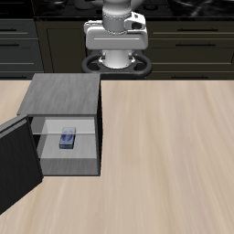

# Refrigerator R0: scene and native-policy development

These are **baseline-only integration probes**, not a hybrid comparison. Two240-step
trials (closed/open door) complete and exactly replay, but neither retrieves the item.
The actor has not yet demonstrated the required opening/grasp skill in this custom
scene. All failed outcomes are retained. No task-family OOD or real-time claim.

* [Execution and diagnosis](../../exp_record/agent_notes/fridge_development_execution_20261019.md)
* [Two-demo/paper design](../../exp_record/agent_notes/two_demo_experiment_design_20261019.md)
* [Measured diagnosis](diagnosis.json), [archive manifest](manifest.json)
* [Independent GitHub/LFS recovery](remote_verified.json): all79archive members
  match their recorded SHA256 hashes after remote download.
* `r0.tar.gz`: three initial scene versions, two actor runs, raw videos, states,
  full-decision logs, exact replay proofs and frozen source copies.

This is a tabletop mini-fridge manipulation scene. The first layout was corrected
before actor outcomes to expose the interior to the camera; the original views are
also retained. The asset's disabled hinge limit is recorded for a future versioned
fix. A future baseline/framework comparison will use the same corrected scene and
publish matched VLA-left/framework-right video. No missing framework panel is invented.
