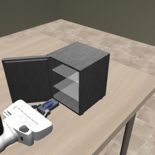

# R1: contact extraction feasibility and frozen actor diagnosis

## Frozen actor cohort completed

All12native-actor trials completed160queries/actions and passed exact independent
replay. None grasped or meaningfully displaced the item (maximum displacement
below6e-13m). These are basic-skill diagnostics, not full-task efficacy trials.
[Final status](actor_launch_final.json) · [374-member archive](actor_cohort.tar.gz) ·
[SHA256 manifest](actor_cohort_manifest.json).

## Side-by-side review (baseline left / our engineering controller right)

[Watch paired MP4](baseline_left_servo_right.mp4) · [pair manifest](baseline_left_servo_right.json)

The initial physics state, controller fingerprint and both camera images match
exactly. Both panels play at20Hz/1x simulated time. Left: seed0 open-door canonical
VLA,160actions/8s. Right: fixed-waypoint contact servo,485actions/24.25s. The left
end frame is explicitly held after8s. Run wall times including setup are shown.
This is an **unequal-budget engineering comparison**, not a framework efficacy
comparison. The right panel contains no VLA, visual localization or handoff. Formal
framework comparisons require matched observation/action/query/time budgets.

Future experiment delivery defaults to baseline-left/framework-right MP4s, with
phase/intervention/handoff labels, all-case indexes and explicit end states.

* [Revised research plan and fixed R1 protocol](../../exp_record/agent_notes/closed_loop_recovery_r1_20261019.md)
* [Execution record](../../exp_record/agent_notes/fridge_r1_execution_20261019.md)
* [Labeled physical extraction video](contact_extraction_diagnostic.mp4)
* [Measured diagnosis](diagnosis.json), [complete engineering archive manifest](manifest.json)
* [Actor launch snapshot](actor_launch_snapshot.json)
* [Independent GitHub/LFS restore](remote_verified.json):208archive members and the
  labeled video downloaded into a fresh repository and SHA256-verified.

`engineering.tar.gz` retains unsuccessful geometry/servo variants, initial launch
errors, source freezes where available, raw videos, physics states and replay reports.
The completed pixel replay is included; the finished actor cohort is separately
archived above. The earliest inventory probes predate
per-run source copying and retain hashes rather than full intermediate source copies.

The video is **scripted geometric control, not OpenVLA or five-layer efficacy**.
Real pad contact lifts the item clear of the shelf and transports it outward by
0.173744m; grasp remains true from step335 through484 (150 control endpoints).
No particle/object teleportation, grasp attachment or actor prefix is involved.
This is not the complete opening/placement/closing task. Physics/controller replay
is exact; six post-action image fingerprints in v5 differ. A second instrumented
run localizes its differences to four wrist frames:30RGBchannel values differ by1.
All main-camera images (the actor's only visual input) are exact in that replay.
This is still not a fully bit-exact two-camera replay; no tolerance was widened.

Twelve native-actor development trials were launched from frozen commit `080c9a4`,
without the scripted prefix. They compare canonical and basic-skill instructions
on closed/open initial doors over seeds0–2. Full-task success is not scored here.
